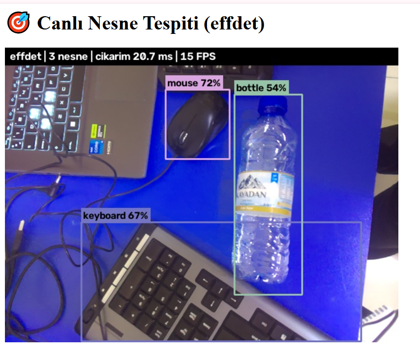
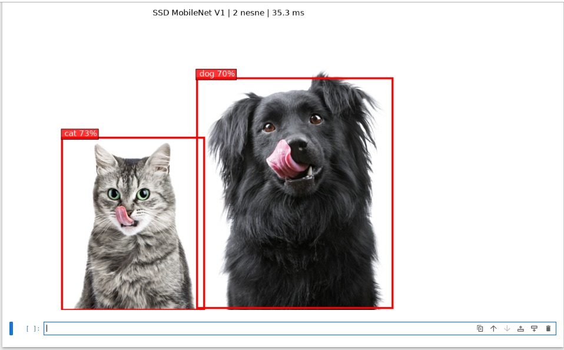
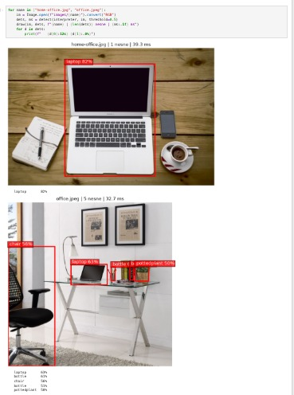
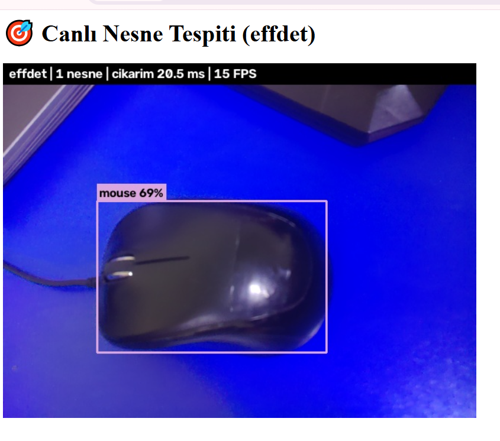

# 🎯 Raspberry Pi 5 — Gerçek Zamanlı Nesne Tespiti (SSD MobileNet vs EfficientDet)

**COCO'da eğitilmiş iki tek aşamalı dedektörü (SSD MobileNet V1, EfficientDet-Lite0) Raspberry Pi 5'te LiteRT ile çalıştırdım, karşılaştırdım ve kameradan ~20 ms'de çoklu nesne tespiti yapan canlı bir web uygulaması yazdım.**
Edge AI serisinin 4. bölümü — 🏆 **Proje 2**.

-C51A4A?logo=raspberrypi&logoColor=white)


<p align="center">
  <br>
  <i>EfficientDet-Lite0, canlı: mouse %72, keyboard %67, bottle %54 — 20.7 ms</i>
</p>

---

## 🎯 Problem: Sınıflandırma yetmez

Bölüm 2'de MobileNet V2'ye bir masa sahnesi gösterdiğimde **"desk %38, notebook %19, laptop %16"** dedi: sınıflandırma bütün resme **tek etiket** verir, birden çok nesne olunca olasılık bölünür.

| | Sınıflandırma | **Nesne tespiti** |
|---|---|---|
| Soru | "Bu resimde **ne** var?" | "**Neler** var ve **nerede**?" |
| Çıktı | 1 etiket + olasılık | Her nesne için etiket + skor + **kutu** |

---

## 📊 Sonuçlar

### SSD MobileNet V1 (2016) vs EfficientDet-Lite0 (2019) — Pi 5, 4 thread, eşik 0.5
| Resim | SSD MobileNet V1 | EfficientDet-Lite0 |
|---|---|---|
| 🐱🐶 cat_dog | 27.5 ms · cat %73, dog %70 | **21.8 ms** · cat **%79**, dog **%77** |
| 💻 home-office | 45.1 ms · laptop %82 | **30.5 ms** · laptop %69, 📱 **cell phone %59**, ☕ **cup %57** |
| 🏢 office | 27.9 ms · laptop, 2× bottle, chair, potted plant | **24.6 ms** · chair **%84**, laptop, potted plant |

➡️ EfficientDet **daha hızlı** ve SSD'nin kaçırdığı **küçük nesneleri** (telefon, kupa) buldu — **BiFPN** sayesinde.
➡️ Ama **her durumda değil**: office'te SSD'nin bulduğu şişeleri kaçırdı. *Daima kendi verinde test et.*

<p align="center">
  
  <br>
  <i>SSD MobileNet V1: kedi–köpek ve ofis sahnesi</i>
</p>

### 🎥 Canlı uygulama (EfficientDet-Lite0)
| Sahne | Tespitler | Çıkarım | Sistem FPS |
|---|---|---|---|
| Tek nesne | mouse %69 | 20.5 ms | 15 |
| Çoklu nesne | mouse %72, keyboard %67, bottle %54 | 20.7 ms | 15 |

<p align="center">
  
  
</p>

---

## 🔍 Modellerin içi

### Giriş
| Model | Giriş | Tip | Quantization | Anlamı |
|---|---|---|---|---|
| SSD MobileNet V1 | 300×300×3 | uint8 | (0.0078125, 128) | Ham 0–255 piksel → içeride [−1, 1] |
| EfficientDet-Lite0 | 320×320×3 | uint8 | (0.0078125, 127) | Ham 0–255 piksel → içeride ≈[−1, 1] |

### Çıkış: 4 tensör
| Çıkış | Shape (SSD / EffDet) | İçerik |
|---|---|---|
| 📦 Boxes | [1, 10, 4] / [1, 25, 4] | `[ymin, xmin, ymax, xmax]`, **normalize** (0–1) |
| 🏷️ Classes | [1, 10] / [1, 25] | COCO sınıf numarası (16 = cat) |
| 📊 Scores | [1, 10] / [1, 25] | Güven skoru (0–1) |
| 🔢 Count | [1] | Geçerli tespit sayısı |

⚠️ **Çıkış sırası modeller arasında farklı** (SSD: `TFLite_Detection_PostProcess:0..3`, EfficientDet: `StatefulPartitionedCall:3..0`). Bu yüzden kod çıkışları **indekse göre değil içeriğe göre** tanıyor:

```python
def read_outputs(itp):
    for o in itp.get_output_details():
        t = ...
        if t.ndim == 2 and t.shape[-1] == 4:  boxes = t      # [N, 4]
        elif t.size == 1:                     count = int(t)  # tek sayı
        elif np.allclose(t, np.round(t)):     classes = t     # hep tam sayı
        else:                                 scores = t      # ondalıklı
```

### Model içi son işleme
Her iki model de sonunda **anchor çözme + NMS (Non-Maximum Suppression)** yapıyor: yüzlerce aday kutudan, aynı nesneye ait örtüşen kutular (IoU > eşik) elenip nesne başına tek kutu kalıyor.

---

## 📁 Repo yapısı

```
├── live_detect.py              # Canlı tespit web uygulaması (python live_detect.py [effdet|ssd])
├── object_detection.ipynb      # Adım adım: model inceleme, tespit, çizim, SSD vs EfficientDet
├── models/
│   ├── ssd-mobilenet-v1-tflite-default-v1.tflite              # 4.0 MB
│   ├── lite-model_efficientdet_lite0_detection_metadata_1.tflite  # 4.4 MB
│   └── coco_labels.txt
├── images/                     # cat_dog.jpeg, home-office.jpg, office.jpeg
├── assets/                     # README görselleri
└── 04-object-detection.md      # Ders notu: teori (IoU, NMS, mAP, SSD, BiFPN) + uygulama + mülakat notları
```

---

## ⚡ Hızlı başlangıç

```bash
source ~/tflite_env/bin/activate            # Bölüm 2'deki venv (ai-edge-litert, opencv, flask)
git clone https://github.com/ebrarklc/raspberry-pi5-object-detection.git
cd raspberry-pi5-object-detection

# Defter
jupyter notebook --ip=0.0.0.0 --no-browser

# Canlı tespit → http://<PI_IP>:5000
python live_detect.py            # EfficientDet-Lite0
python live_detect.py ssd        # SSD MobileNet V1
```

---

## 🧠 Öğrenilen dersler

| Durum | Ders |
|---|---|
| SSD home-office'te kupa ve telefonu kaçırdı | 300×300'e küçültülünce küçük nesneler ~20 piksel kalıyor; **çok ölçekli özellik birleştirme (BiFPN)** fark yaratıyor. |
| Bazı kutu koordinatları 0–1 dışında (−0.014, 1.009) | Çizmeden önce **`np.clip(box, 0, 1)`**. |
| Düşük skorlu tespitler: "diningtable %12" | **Eşik = precision/recall takası.** 0.5 iyi bir başlangıç; doğru değer uygulamaya bağlı. |
| Etiket dosyasında `streetsign` gibi "hayalet" sınıflar | COCO 91 ID kullanır, 80'i etiketli. Etiket dosyası modelin **indeks şemasıyla birebir** eşleşmeli (off-by-one tuzağı). |
| İki modelin çıkış sırası farklı | Çıkışları **içerik/şekle göre** eşle; indekse güvenen kod model değişince sessizce bozulur. |
| Okulda Jupyter `Cannot assign requested address` | Farklı ağ = farklı IP. Sunucular **`0.0.0.0`** ile dinlemeli; bağlantıda `raspi-5.local`. |
| Taşıma sonrası `No camera number 0 found` | Gevşek şerit kablo. Önce **donanım görülüyor mu?** (`rpicam-hello --list-cameras`, `dmesg`). |
| Model ~20 ms (≈50 FPS'e yeter), sistem 15 FPS | Darboğaz yine model değil: kamera yakalama + çizim + JPEG + akış zinciri. |

---

## 🚀 Geliştirme fikirleri
- [ ] SSD ve EfficientDet'i **canlıda yan yana** karşılaştırma
- [ ] Kendi veri setimle (Roboflow etiketleme) **özel nesne dedektörü** eğitimi (SSD MobileNetV2 / FOMO / YOLO — kitabın sonraki bölümleri)
- [ ] Nesne **takibi** (tracking) ve sayma
- [ ] Kamera yakalama ile çıkarımı ayrı thread'lere bölerek sistem FPS'ini artırma

---

## 🗺️ Edge AI serisi

| # | Bölüm | Repo |
|---|---|---|
| 1 | Raspberry Pi 5 kurulumu | [raspberry-pi5-edge-ai-setup](https://github.com/ebrarklc/raspberry-pi5-edge-ai-setup) |
| 2 | Görüntü sınıflandırma temelleri | [raspberry-pi5-image-classification-litert](https://github.com/ebrarklc/raspberry-pi5-image-classification-litert) |
| 3 | 🏆 Kendi görüntü sınıflandırıcım | [raspberry-pi5-custom-image-classifier](https://github.com/ebrarklc/raspberry-pi5-custom-image-classifier) |
| 4 | 🏆 Nesne tespiti | 📍 *bu repo* |

---

## 📚 Kaynaklar
- Marcelo Rovai — *Edge AI Engineering: Hands-On with the Raspberry Pi* (UNIFEI, 2026), s. 146–168
- Liu et al. (2016) — *SSD: Single Shot MultiBox Detector*
- Tan, Pang, Le (2020) — *EfficientDet: Scalable and Efficient Object Detection*
- Lin et al. (2014) — *Microsoft COCO: Common Objects in Context*
- Modeller ve test resimleri: [Mjrovai/EdgeML-with-Raspberry-Pi](https://github.com/Mjrovai/EdgeML-with-Raspberry-Pi)

## 👤 Hazırlayan
**Ebrar Kılıç** — Edge AI & Embedded Systems · [github.com/ebrarklc](https://github.com/ebrarklc)
